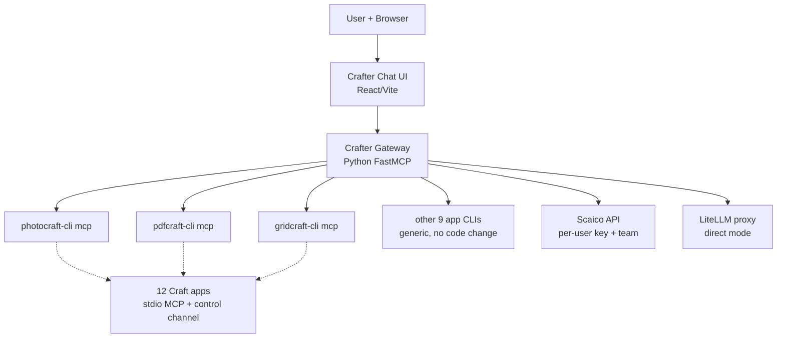

# Crafters Architecture

> **Purpose**: Living architecture overview for the Crafter Gateway + Chat UI project —
> the connector and chat application that makes the 12 storytold Craft apps agent-accessible.
> Entry point read by every agent at Task 0.0.
> **Last updated by**: TC-C-02 (EPIC_002 boundary), 2026-10-12

## Technology Stack

| Layer | Choice | Notes |
|:------|:-------|:------|
| Gateway service | Python FastMCP | Mirrors swaibian-one `src/mcp/main.py`; stdio + streamable_http |
| Gateway auth | Bearer tokens + per-token tool allowlists | Scaico team format requires streamable_http |
| LLM integration | Controller-side LiteLLM proxy | Keys server-side, per-user budgets |
| Chat UI | React/Vite | Reuses SharedChatSection patterns (markdown+GFM/KaTeX, toolcall blocks) |
| Streaming | SSE (`send_task_stream` pattern) | Proven in swaibian-one `scaico_client.py` |
| Packaging | Docker (web first) | Matches swaibian-one `deploy/` + scaico compose; Electron deferred |
| Pilot apps | photocraft, pdfcraft, gridcraft | Raster, document, data; gateway generic for the other 9 |
| Containment | Container + per-session filesystem roots | 8/12 apps lack confinement |

## System Architecture

See [component-overview.md](diagrams/component-overview.md):

## Data Model

See [data-model.md](diagrams/data-model.md). Session-scoped: sessions, roots, bearer tokens +
allowlists, snapshots, records, artifacts. No swaibian-one schema changes (reuse by reference).

## API Contracts

See [api-contracts.md](diagrams/api-contracts.md). Gateway tools Phase 1+2 (`craft_apps`,
`craft_status`, `craft_run`, `craft_run_tool`, `craft_app_call`, `craft_look`,
`craft_snapshot`/`craft_restore`, `craft_record`, `craft_assert`) + perception
(`craft_widgets`, `craft_map`); SSE chat stream; settings
endpoints (Scaico connect, LiteLLM direct, gateway endpoint).

## Key Flows

- [flow-chat-file-open.md](diagrams/flow-chat-file-open.md): tool picker → drag/drop → file opens
  in app → chat enables. Populated by the TC's last implementation issue.
- [flow-agent-edit-verify.md](diagrams/flow-agent-edit-verify.md): snapshot → act → look →
  assert → record. Populated by the TC's last implementation issue.

## Architecture Decisions

| ADR | Title | Status |
|:----|:------|:-------|
| _none yet_ | First ADRs land with TC closers | — |

## Traceability

- [requirements-matrix.md](traceability/requirements-matrix.md): SYS1→SWE1→SWE3→SWE4 mapping.
  Headers populated; rows filled by TC closers.
- [coverage-map.md](traceability/coverage-map.md): coverage per SW-REQ. Populated by TC closers.

## Change Log

| Date | Issue | Change |
|:-----|:------|:-------|
| 2026-10-11 | swaibian-architect-no-reviews | Initial scaffold (EPIC_001 + EPIC_002 planning) |
| 2026-10-11 | TC-A-02 (EPIC_001 TC-A closer) | Gateway core: transports, auth, Phase-1 tools, pilot wiring |
| 2026-10-11 | TC-B-02 (EPIC_001 TC-B closer) | Verify tools, containment, token bootstrap, deploy/ |
| 2026-10-12 | TC-C-02 (EPIC_001 boundary) | Perception tools, a11y PR drafts + pattern doc; **EPIC_001 ✅ complete** (158 gateway tests) |
| 2026-10-12 | TC-C-02 (EPIC_002 boundary) | Controller (settings/agent loop/adapters) + view (chat/settings/SSE) + compose; **EPIC_002 ✅ complete** — 236 tests green (158+47+31) |
| 2026-10-12 | Lane 5 (docs, gates & ship) | Ship-readiness audit: 6 EPIC_001 reports downgraded to Partial (fake-backend only / drafts-only, see Lane 5 audit sections); EPIC_001 → ⚠️ Partial, EPIC_002 → ✅ Complete; suites re-executed 337 passed + 9 skipped (188+77+72); gateway healthcheck 4xx-tolerant; Dropzone preview-state fix; `docs/DEMO.md` 4-step northstar |
