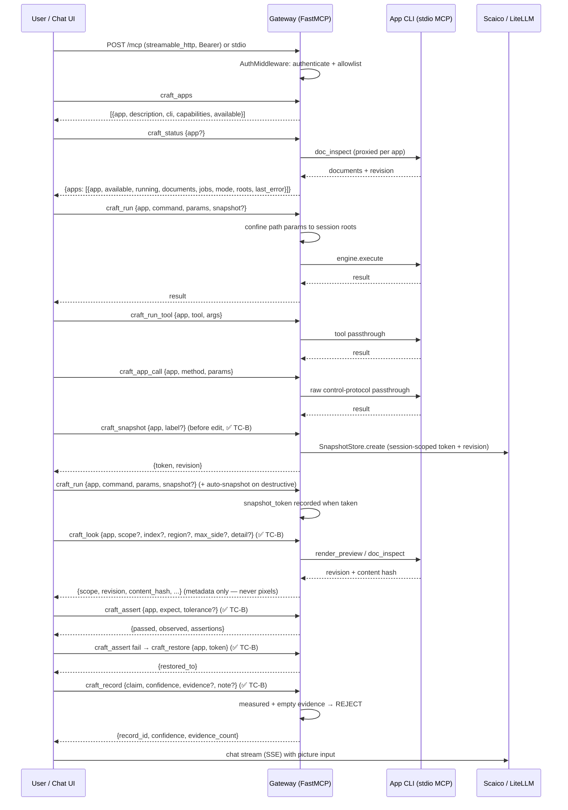

# API Contracts

> Last updated by: TC-C-02 (Accessibility Refs closer, EPIC_001 boundary), 2026-10-12

| Contract | Description |
|:---------|:------------|
| Gateway tools (Phase 1, ✅ TC-A) | `craft_apps()` → app catalog; `craft_status(app?)` → per/all-app state; `craft_run(app, command, params?, snapshot?)` → guarded `engine.execute` (+ auto-snapshot on destructive); `craft_run_tool(app, tool, args?)` → curated-tool passthrough; `craft_app_call(app, method, params?)` → raw escape hatch. Errors: `ToolError("access denied")` (auth/roots), `ToolError("unknown app: …")`, backend failures surfaced safely |
| Gateway tools (Phase 2, ✅ TC-B) | `craft_look(app, scope?, index?, region?, max_side?, detail?, layer?, path?)` → `{scope, revision, content_hash}` (metadata only); `craft_snapshot(app, label?)` → `{token, revision}`; `craft_restore(app, token)` → `{restored_to}` (session-scoped, app-matched); `craft_record(claim, confidence, evidence?, note?)` → `{record_id, ...}` (`measured` + empty evidence → `ToolError`); `craft_assert(app, expect, tolerance?)` → `{passed, observed, assertions}` (structural default; visual requires tolerance) |
| Containment (✅ TC-B) | `SessionRegistry.check_path` on every file param (`path/output_path/file/filename`): lexical + realpath symlink second opinion; every decision audited to `gateway.audit` as `{session_id, ok, error_code}` — filesystem paths never logged |
| Local run (✅ TC-B) | `CRAFTER_DEV_TOKEN` (loopback-only wildcard, refuses non-loopback binds) + `CRAFTER_TOKENS_FILE` JSON provisioning + `--work-dir` default roots; `deploy/` compose for containerised run |
| Perception (✅ TC-C) | `craft_widgets(app, query?, role?, focused?, limit?=500)` → `{widgets, count, truncated, query_map_ids}` (AccessKit shape; text intact for callers, structure-only in logs); `craft_map(app, direction, point?, zoom?, centre?, view_size?, canvas_size?)` → `{result, query_map_id}` (`doc_to_screen`/`screen_to_doc`/`canvas_rect`) |
| Transport + auth (✅ TC-A) | stdio (local agents; token via `_gateway_token` arg, stripped pre-dispatch) + streamable_http `POST /mcp` with `Authorization: Bearer`; per-token allowlists server-enforced; `tools/list` filtered to allowed tools |
| Chat stream | SSE text + image input, markdown + toolcall blocks |
| Settings | Scaico key + team select, mailto fallback, LiteLLM direct toggle, gateway endpoint |
| Auth | Per-user Scaico keys; gateway bearer tokens; per-user denial, session isolation, no token leakage |

Populated by the TCs' last implementation issues.
