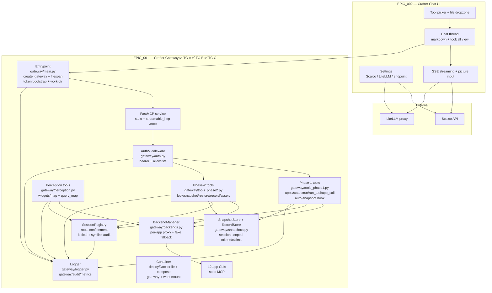

# Component Overview

> Last updated by: TC-C-02 (Accessibility Refs closer, EPIC_001 boundary), 2026-10-12

| Element | Description |
|:--------|:------------|
| Tool picker + file dropzone | Select app, drag/drop file → opens in app, enables chat |
| Chat thread | Streamed markdown replies with inline toolcall blocks |
| Settings | Scaico key + team select, mailto fallback, LiteLLM direct toggle |
| FastMCP service | `gateway/main.py::create_gateway` — stdio + streamable_http (`POST /mcp`), lifespan owns backend shutdown |
| AuthMiddleware | `gateway/auth.py` — bearer validation, per-token allowlists, `tools/list` filtering; stdio token via `_gateway_token` arg (stripped pre-dispatch) |
| Phase-1 tools | `gateway/tools_phase1.py` — craft_apps/status/run/run_tool/app_call; allowlist re-check, roots confinement, redacted logging; `craft_run` auto-snapshot hook (`snapshot=True` or destructive command) |
| Phase-2 tools | `gateway/tools_phase2.py` — craft_look (metadata + hash, never pixels), craft_snapshot/restore (session-scoped tokens), craft_record (measured-requires-evidence), craft_assert (structural default, visual opt-in + tolerance) |
| Perception tools | `gateway/perception.py` — craft_widgets (AccessKit shape + query/role/focused/limit + `query_map_ids`), craft_map (doc↔screen + canvas rect + `query_map_id`); `QueryMap` per-session store; upstream drafts in `docs/upstream-prs/`, pattern in `docs/a11y-contribution-pattern.md` |
| SnapshotStore + RecordStore | `gateway/snapshots.py` — token → app/session/revision/data-ref; claim ledger; `is_destructive_command` policy predicate |
| BackendManager + SessionRegistry | `gateway/backends.py` — one backend per app (`<app>-cli mcp` stdio, `FakeAppBackend` fallback); sessions share backends, isolate via roots; `check_path` = lexical + realpath symlink second opinion, every decision audited (paths never logged) |
| Entrypoint | `gateway/main.py` — token bootstrap (`CRAFTER_DEV_TOKEN` loopback-only, `CRAFTER_TOKENS_FILE`/``--tokens-file`` JSON), `--work-dir` default roots, shared SnapshotStore across Phase-1/2 |
| Container | `deploy/Dockerfile` + `deploy/docker-compose.yml` — gateway image (pilot CLI install hooks), local run with work-dir mount |
| Logger | `gateway/logger.py` — stdlib `gateway` / `gateway.audit` / `gateway.metrics`; `safe_event` allow-list + `redact_value` scrub |
| 12 app CLIs | Existing `<app>-cli mcp` processes, pilot: photocraft/pdfcraft/gridcraft (registry in `tools_phase1.py::APP_REGISTRY`; other 9 = registry entries, no code change) |

Populated by the TCs' last implementation issues.
