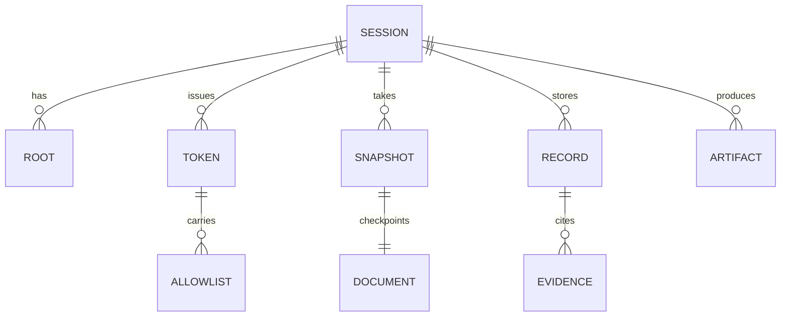

# Data Model

> Last updated by: swaibian-architect-no-reviews, 2026-10-11

| Entity | Description |
|:-------|:------------|
| SESSION | Chat/gateway session; owns roots, tokens, snapshots, records, artifacts |
| ROOT | Per-session filesystem read/write root (containment) |
| TOKEN | Gateway bearer token with tool allowlist |
| ALLOWLIST | Tool names permitted for a token |
| SNAPSHOT | File-level document checkpoint (label, revision, token) |
| RECORD | Claim + confidence + evidence refs (anti-hallucination) |
| ARTIFACT | Produced file with provenance (agent, calls, renders, claims) |
| DOCUMENT | Craft app document opened in a session |
| EVIDENCE | Render / assert / resource reference backing a record |

Populated by the TCs' last implementation issues.
