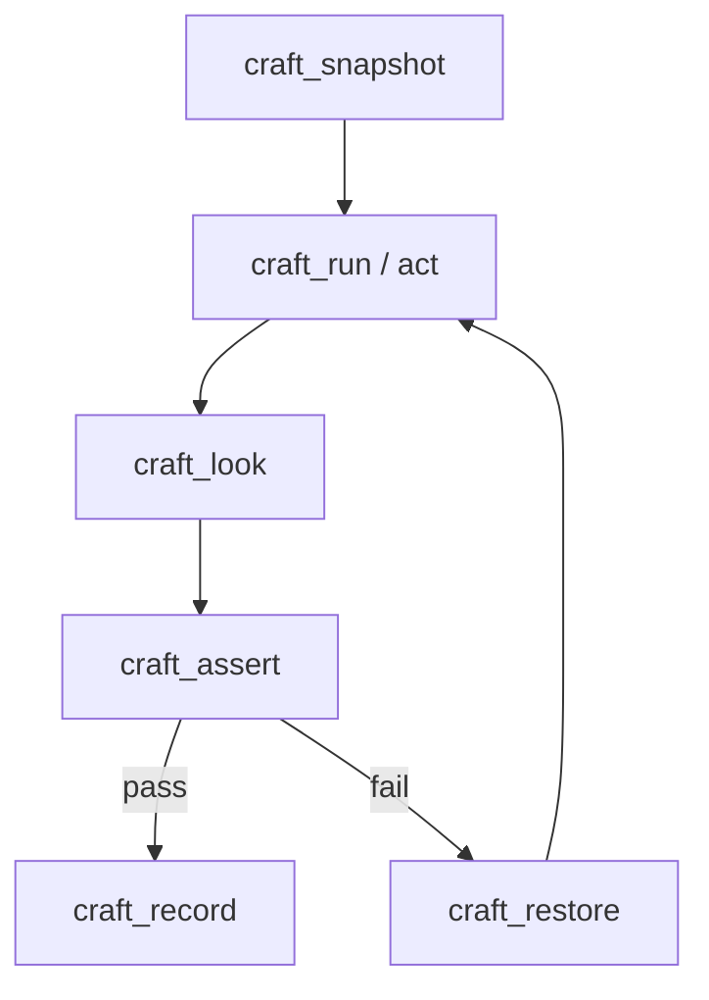

# Flow: Agent Edit Verify

> Last updated by: swaibian-architect-no-reviews, 2026-10-11

| Step | Description |
|:-----|:------------|
| Snapshot | File-level checkpoint before destructive work |
| Act | Guarded command execution |
| Look | Unified render of the result |
| Assert | Structural (default) / visual postconditions |
| Record | Claim + evidence, rejects unbacked "measured" claims |
| Restore | Rollback path on assertion failure |

Populated by the TC's last implementation issue.
