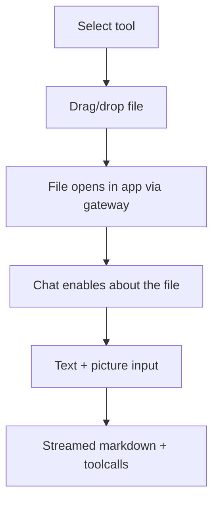

# Flow: Chat File Open

> Last updated by: swaibian-architect-no-reviews, 2026-10-11

| Step | Description |
|:-----|:------------|
| Select tool | Tool picker sets active Craft app |
| Drag/drop file | File input lands in session write root |
| File opens | Gateway opens document in the app CLI session |
| Chat enables | Thread bound to opened document |
| Interact | Streaming replies, toolcall view, snapshot/restore + verify |

Populated by the TC's last implementation issue.
