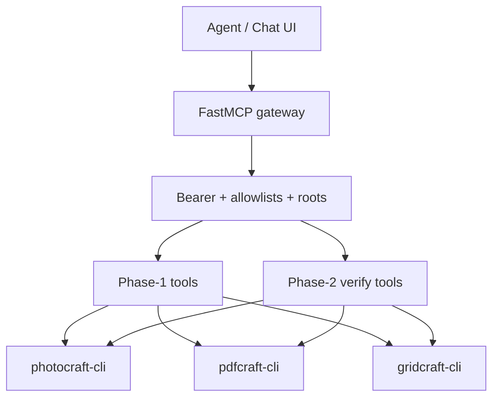

# Epic 001: Crafter Gateway

**ID**: E-001
**V-Model**: SYS1-001
**Status**: ⚠️ Partial — fake-backend only (downgraded by Lane 5 audit 2026-10-12; was ✅ Complete)
**Priority**: P0-Critical
**Created**: 2026-10-11
**Last Updated**: 2026-10-12

**Review Mode**: no-reviews — this epic runs without SWE5 review issues. Every issue is a SWE3
implementation issue; each TC's last issue is the closer and owns review/docs duties
(self-verify per STEP E-NR, gap analysis, integration tests, arch docs, SYS3 smoke).

---

## Vision

A Python FastMCP gateway service that fronts the 12 storytold Craft app CLIs behind one
tool surface with bearer-token auth and per-token allowlists, plus the verification tools and
accessibility reference contributions that make agent-driven editing trustworthy. Without it,
agents must hand-assemble 12 stdio MCP configs and there is no snapshot/assert/record safety
net — the Craft suite stays developer-only.

## Goals

1. Gateway serves Phase 1 tools (`craft_apps`, `craft_status`, `craft_run`, `craft_run_tool`,
   `craft_app_call`) over stdio + streamable_http against pilot apps (photocraft, pdfcraft,
   gridcraft) with per-session roots.
2. Phase 2 verification tools (`craft_look`, `craft_snapshot`/`craft_restore`, `craft_record`,
   `craft_assert`) work end-to-end; unbacked "measured" claims are mechanically rejected.
3. Accessibility reference PRs land for 2 pilot apps (pdfcraft AccessKit-via-MCP, photocraft
   canvasRect) with a contribution pattern doc for the remaining 10.

## Scope

### In Scope

- FastMCP service, stdio + streamable_http transports, bearer + allowlists, pilot wiring.
- Verification tools, per-session filesystem roots, containerised local run.
- 2-app accessibility reference PRs + pattern doc.

### Out of Scope

- 12-app accessibility rollout (deferred).
- Session recording/replay + audit log (deferred H3).
- Cross-app pipeline templates (deferred H4).
- Shared MCP shell upstream to `craft-libs` (deferred H5).
- Chat UI (EPIC_002), Electron shell, cloud generation integration.

## Requirements (SYS1)

| Requirement | Title | V-Model | Link |
|:------------|:------|:--------|:-----|
| SW-REQ-GW-CORE | Gateway core + Phase-1 tools | SWE1 | TC-A definition |
| SW-REQ-GW-VERIFY | Verification tools + containment | SWE1 | TC-B definition |
| SW-REQ-A11Y | Accessibility reference PRs + pattern | SWE1 | TC-C definition |

## System Architecture (SYS2)

### Key Architectural Decisions

| Decision | Choice | Rationale | ADR |
|----------|--------|-----------|-----|
| Gateway stack | Python FastMCP | Mirrors swaibian-one `src/mcp/main.py`; reuses auth/catalog | none yet |
| Transports | stdio + streamable_http w/ bearer + allowlists | Scaico team format requires streamable_http | none yet |
| Pilot apps | photocraft + pdfcraft + gridcraft | Raster, document, data; gateway generic for rest | none yet |
| Containment | Container + per-session roots | 8/12 apps lack confinement | none yet |

### Component Interaction

Detailed diagrams: `project_management/architecture/diagrams/`.

## Technical Components

| TC | Name | V-Model | Issues | Review Issues | Status |
|:---|:-----|:--------|:-------|:--------------|:-------|
| TC-A | GATEWAY_CORE | SWE1-A | 2 | none (no-reviews; TC-A-02 closes) | ⚠️ Partial (fake-backend only) |
| TC-B | VERIFY_AND_CONTAIN | SWE1-B | 2 | none (no-reviews; TC-B-02 closes) | ⚠️ Partial (fake-backend only) |
| TC-C | ACCESSIBILITY_REFS | SWE1-C | 2 | none (no-reviews; TC-C-02 closes) | ⚠️ Partial (drafts only, never submitted) |

Delivered: 12-tool gateway (Phase-1 + Phase-2 + perception), bearer+allowlists,
session roots + symlink audit, token bootstrap, `deploy/` local run, 2 a11y PR
drafts + contribution pattern. 188 gateway tests passed + 9 skipped (real-CLI tests, no binaries), re-executed 2026-10-12.
NOT delivered (TODO): real-CLI proxy verification (no `*-cli` binaries installed —
FakeAppBackend active everywhere), upstream PR submission (drafts only in
`docs/upstream-prs/`). Consumer: EPIC_002 (via fake-mode tools + real controller adapters).

## Test Plan

| V-Level | Test Type | Scope | Gate | Notes |
|---------|-----------|-------|------|-------|
| SWE4 | Unit tests | Every issue | 🔴 MANDATORY | Project test runner |
| SWE5 | Integration tests | TC closers (self-verify) | 🔴 MANDATORY | Cross-module, no SWE5 issue |
| SWE6 | TC acceptance | TC completion | 🟡 CONDITIONAL | If acceptance suite exists |
| SYS3 | E2E / system | TC closers (smoke) | 🟡 CONDITIONAL | Start gateway → tool call → verify |

## Dependencies

- 12 Craft app CLIs installed (`photocraft-cli`, `pdfcraft-cli`, `gridcraft-cli` for pilot).
- swaibian-one `src/mcp/main.py` + `api_key_auth`/`mcp_auth` (reuse by reference).
- Prior research: `_templates/raw_Repository_findings/08-REQUIRED-TOOLS.md` (Phase 1+2).

## Risks

| Risk | Impact | Mitigation |
|:-----|:-------|:-----------|
| Upstream PRs not accepted | Part A stalls | Gateway synthesis fallback; pattern still useful |
| 8/12 apps lack confinement | Agent file escape | Container + per-session roots; snapshots |
| Token leakage (gateway bearer) | Auth bypass | Server-side storage, per-user denial tests, no token in logs |
| Tool-count blowup in agent context | Agent degradation | Allowlists; pilot 3 apps first |
