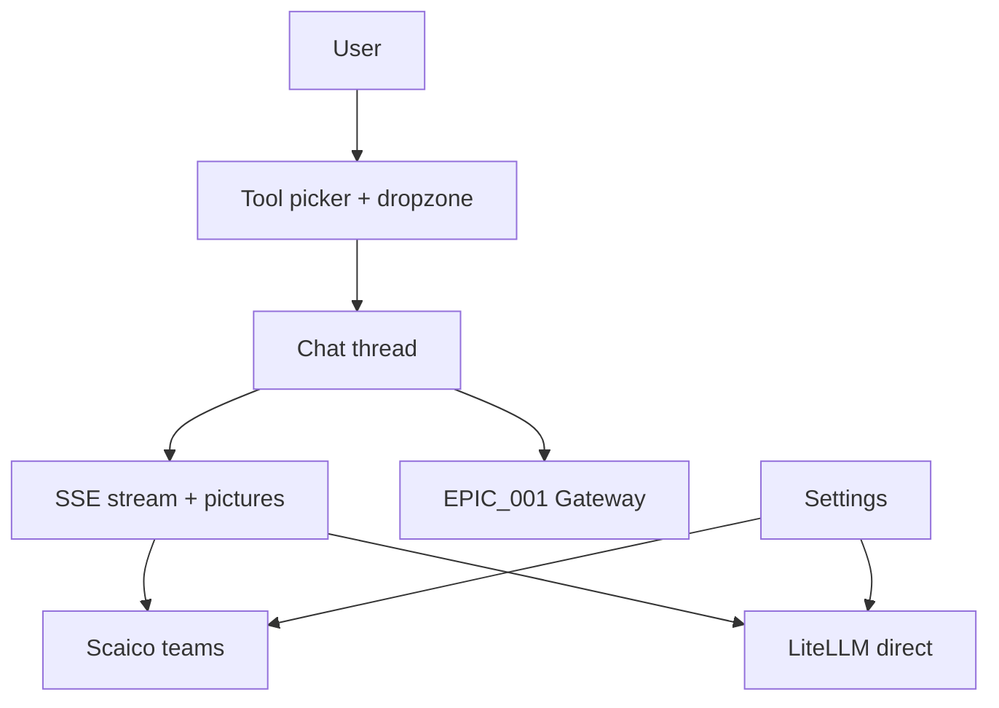

# Epic 002: Crafter Chat UI

**ID**: E-002
**V-Model**: SYS1-002
**Status**: ✅ Complete
**Priority**: P0-Critical
**Created**: 2026-10-11
**Last Updated**: 2026-10-12

**Review Mode**: no-reviews — this epic runs without SWE5 review issues. Every issue is a SWE3
implementation issue; each TC's last issue is the closer and owns review/docs duties
(self-verify per STEP E-NR, gap analysis, integration tests, arch docs, SYS3 smoke).

---

## Vision

A web chat application where a user picks a Craft tool, drags in a file, and chats with agents
that work inside the real application — streamed markdown replies with toolcall views, picture
input, Scaico team wiring with a mailto fallback, and a local LiteLLM direct mode. Without it,
the gateway from EPIC_001 has no human interface and the Craft suite stays developer-only.

## Goals

1. Tool picker + drag/drop file flow works: file opens in the selected app, chat enables about
   that file, edits are snapshot-guarded with verify actions.
2. Chat streams markdown + toolcalls with picture input; settings connect Scaico (key + team
   select) or fall back to mailto CTA / LiteLLM direct mode.
3. Docker-packaged local run works fresh-checkout; Scaico team select drives agents end-to-end.

## Scope

### In Scope

- Chat UI (tool picker, file flow, markdown + toolcall view), streaming + picture input,
  settings (Scaico/LiteLLM/endpoint), Docker compose, team select + mailto fallback, e2e smoke.
- Reuse of swaibian-one patterns (SharedChatSection, chat-image pipeline, send_task_stream).

### Out of Scope

- Electron shell (deferred; web + Docker first).
- Session recording/replay + audit log (deferred H3).
- Cross-app pipeline templates (deferred H4).
- Cloud generation integration; mobile layout.

## Requirements (SYS1)

| Requirement | Title | V-Model | Link |
|:------------|:------|:--------|:-----|
| SW-REQ-CHAT | Chat UI + file flow | SWE1 | TC-A definition |
| SW-REQ-STREAM | Streaming + picture + settings | SWE1 | TC-B definition |
| SW-REQ-PACK | Packaging + Scaico teams e2e | SWE1 | TC-C definition |

## System Architecture (SYS2)

### Key Architectural Decisions

| Decision | Choice | Rationale | ADR |
|----------|--------|-----------|-----|
| Chat UI | React/Vite, SharedChatSection patterns | Markdown+GFM/KaTeX, toolcall blocks exist | none yet |
| Streaming | SSE via send_task_stream pattern | Proven in scaico_client.py | none yet |
| LLM | Controller-side LiteLLM proxy | Keys server-side, budgets | none yet |
| Scaico auth | Per-user key + team select; mailto fallback | Epic 003 patterns | none yet |
| Packaging | Web + Docker first | swaibian-one deploy/ + compose | none yet |

### Component Interaction

Detailed diagrams: `project_management/architecture/diagrams/`.

## Technical Components

| TC | Name | V-Model | Issues | Review Issues | Status |
|:---|:-----|:--------|:-------|:--------------|:-------|
| TC-A | CHAT_AND_FILES | SWE1-A | 2 | none (no-reviews; TC-A-02 closes) | ✅ |
| TC-B | STREAM_AND_SETTINGS | SWE1-B | 2 | none (no-reviews; TC-B-02 closes) | ✅ |
| TC-C | PACKAGE_AND_TEAMS | SWE1-C | 2 | none (no-reviews; TC-C-02 closes) | ✅ |

Delivered: chat UI (picker + dropzone + thread + toolcalls + settings with
custom endpoints/keys + SSE stream), controller (settings/profiles/teams +
agent do/see/reason loop + real xlsx/png/pdf adapters + MockBrain),
compose packaging. 337 tests passed (0 failed) + 9 skipped, re-executed 2026-10-12 by Lane 5
(188 gateway + 77 controller + 72 view). Demo: `docs/DEMO.md`.

## Test Plan

| V-Level | Test Type | Scope | Gate | Notes |
|---------|-----------|-------|------|-------|
| SWE4 | Unit tests | Every issue | 🔴 MANDATORY | Project test runner |
| SWE5 | Integration tests | TC closers (self-verify) | 🔴 MANDATORY | Cross-module, no SWE5 issue |
| SWE6 | TC acceptance | TC completion | 🟡 CONDITIONAL | If acceptance suite exists |
| SYS3 | E2E / system | TC closers (smoke) | 🟡 CONDITIONAL | Start stack → chat → verify |

## Dependencies

- EPIC_001 gateway (tools, sessions, verify primitives).
- swaibian-one patterns by reference: SharedChatSection, chat-image pipeline, send_task_stream,
  epic 003/005/006/009 flows.
- Scaico API (per-user keys); `Scaico_Teams/teams/*.json` team definitions.

## Risks

| Risk | Impact | Mitigation |
|:-----|:-------|:-----------|
| Scaico access unavailable | Team mode dead-ends | mailto CTA + LiteLLM direct mode |
| Streaming complexity (SSE + toolcalls) | Janky UX | Reuse send_task_stream + SharedChatSection patterns |
| Picture pipeline cost | Large uploads stall chat | Reuse epic 005 upload/resize/serving |
| Scope creep (Electron, mobile) | Misses cap | Explicitly deferred; web + Docker only |
